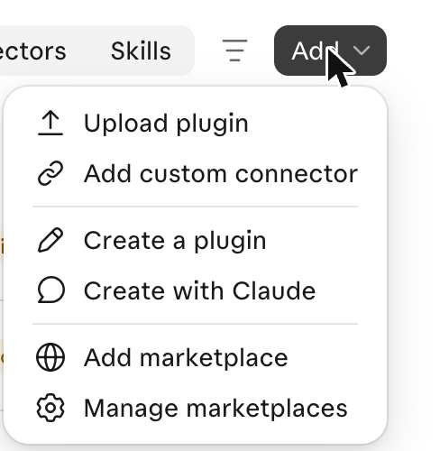
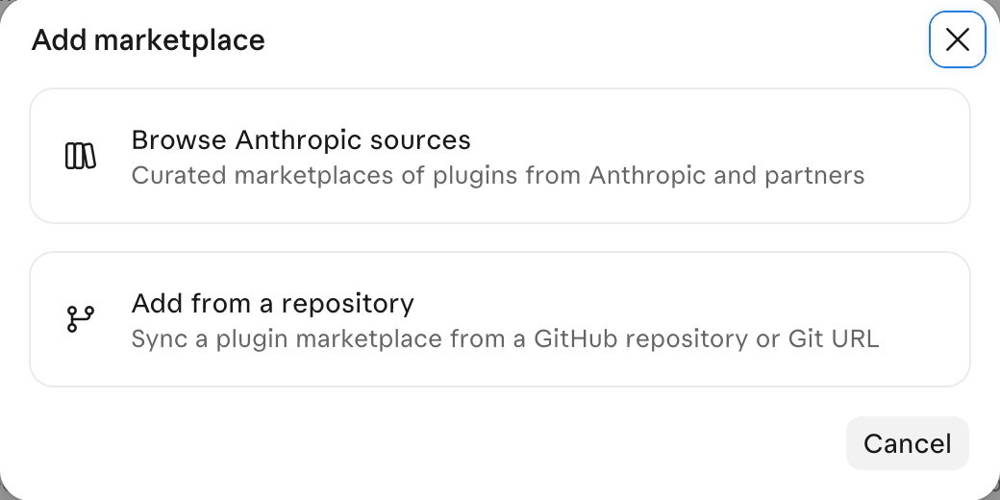
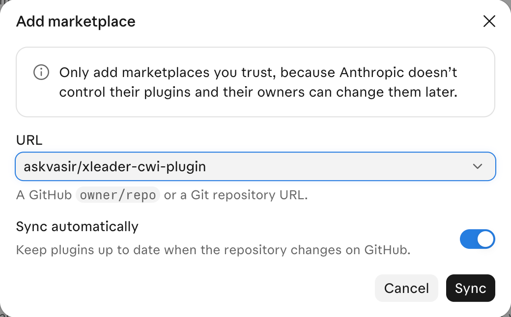
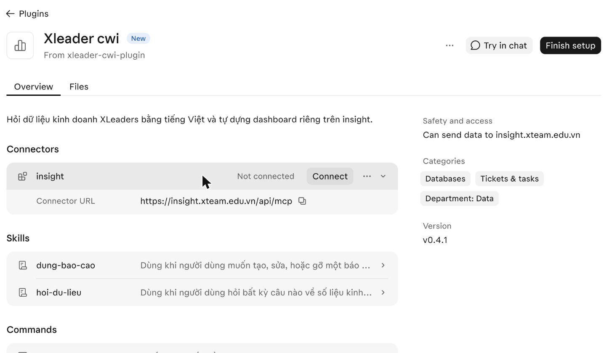
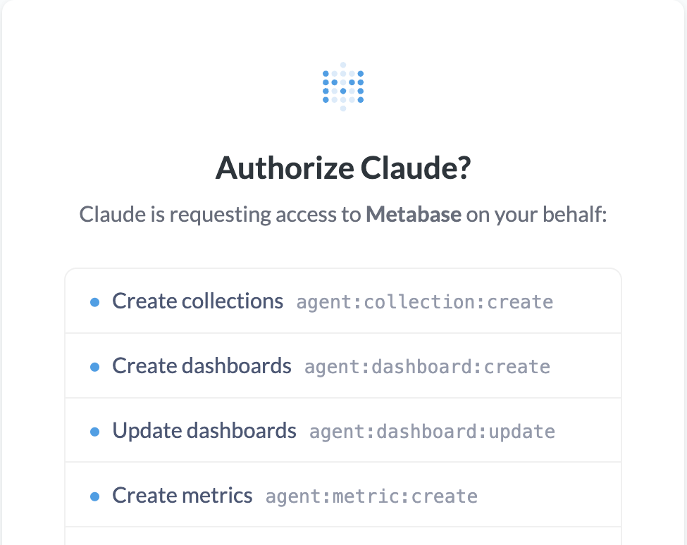
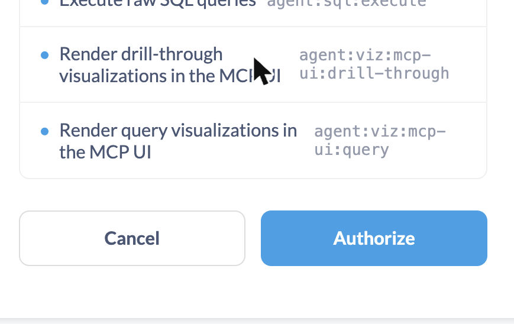
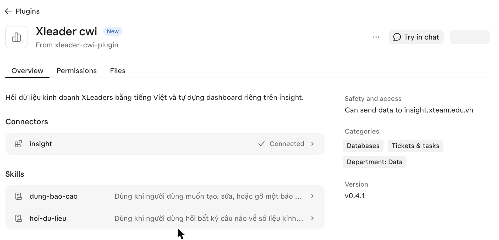
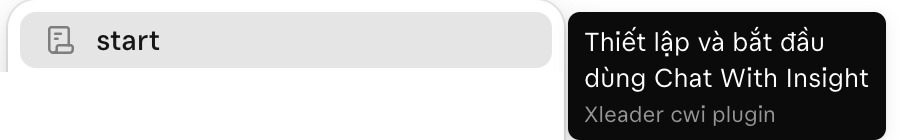
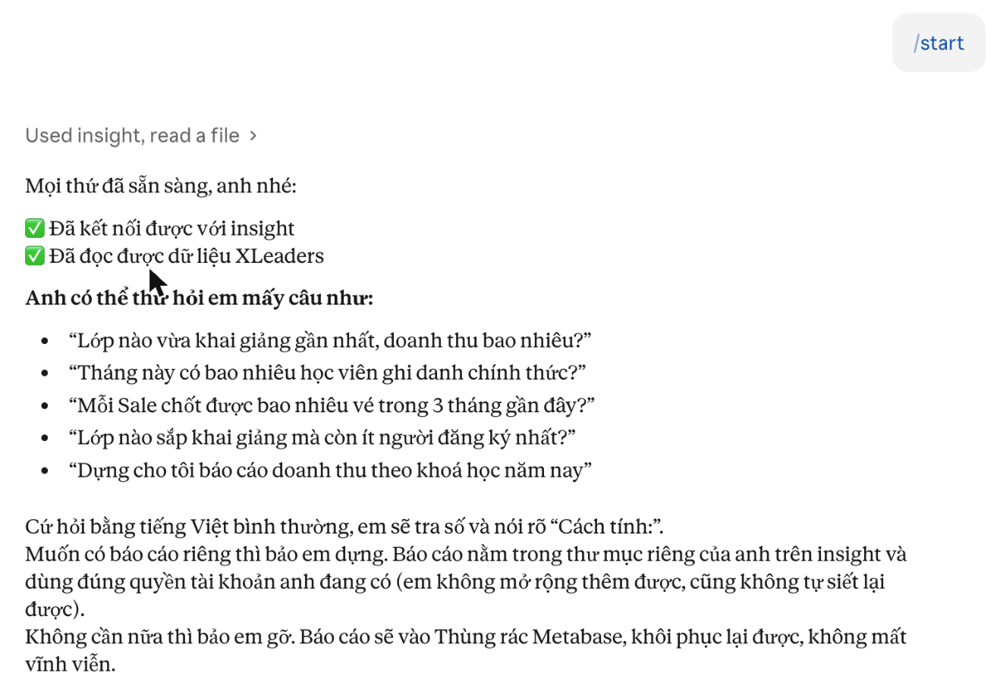
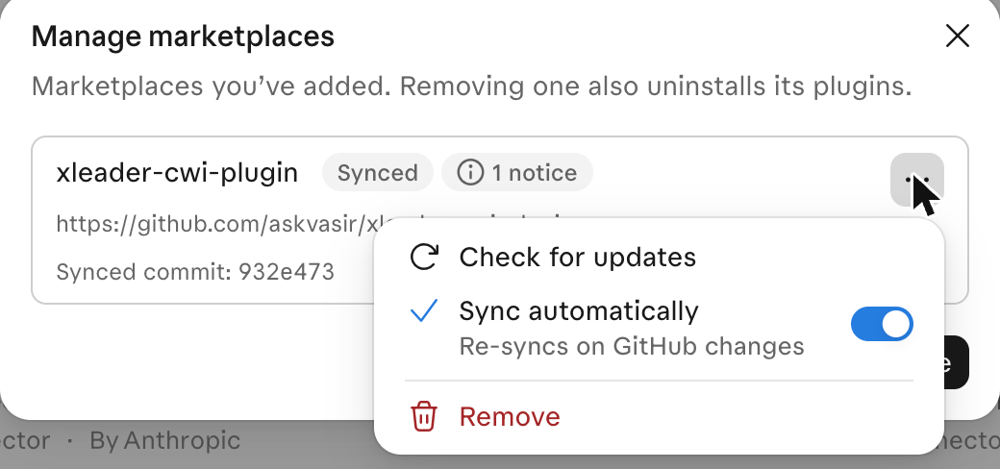

# Chat With Insight (CWI)

Hỏi số liệu kinh doanh XLeaders bằng tiếng Việt và tự dựng báo cáo riêng trên `insight.xteam.edu.vn`, ngay
trong Claude, không cần biết SQL.

Repo này **chỉ chứa hướng dẫn** để Claude biết cách tính từng chỉ số. Repo **không** chứa số liệu nào. Mọi con
số Claude trả lời đều được đọc trực tiếp từ insight, bằng chính tài khoản insight của bạn: chưa đăng nhập
insight thì không có số nào cả.

## Cần có trước khi cài

- Một tài khoản Claude **trả phí** (Pro, Max…), mở bằng app Claude trên máy tính hoặc tại <https://claude.ai>.
- Một tài khoản **insight** (`https://insight.xteam.edu.vn`) đăng nhập được. Chưa có hoặc quên mật khẩu thì nhờ
  người quản trị insight cấp lại trước.
- **Không** cần tài khoản GitHub, **không** cần tự thêm "custom connector".

## Cài đặt (khoảng 3 phút, làm một lần)

Các bước dưới đây làm y hệt nhau trên app Claude (máy tính) và trên claude.ai.

### Bước 1. Mở trang Plugins → Add → Add marketplace

Mở **Customize → Plugins** (thanh bên trái, mục **Plugins**). Bấm nút **Add** ở góc trên bên phải, chọn
**Add marketplace**.



### Bước 2. Chọn "Add from a repository"



### Bước 3. Dán địa chỉ repo, giữ "Sync automatically" đang bật, bấm Sync

Ô **URL** dán đúng dòng sau:

```
askvasir/xleader-cwi-plugin
```

Để nguyên công tắc **Sync automatically** ở trạng thái bật (màu xanh), rồi bấm **Sync**.



### Bước 4. Cài plugin "Xleader cwi"

Sau khi Sync, Claude hiện danh sách plugin của marketplace vừa thêm. Bấm vào **Xleader cwi**, rồi bấm nút **Add**
ở góc trên bên phải trang plugin. Góc dưới màn hình hiện thông báo *"Xleader cwi is added."*.

### Bước 5. Bấm "Finish setup" để kết nối insight

Vẫn ở trang plugin **Xleader cwi**: mục **Connectors** có dòng **insight** ghi *Not connected*. Bấm nút
**Finish setup** ở góc trên bên phải (hoặc bấm **Connect** trên dòng **insight**).



> Nếu bấm **Connect** mà Claude mở hộp **Add custom connector** đã điền sẵn tên `insight` và địa chỉ
> `https://insight.xteam.edu.vn/api/mcp`: bấm **Continue**, giữ nguyên các lựa chọn, bấm **Add**.

### Bước 6. Đăng nhập insight (nếu được hỏi) và bấm Authorize

- Trình duyệt chưa đăng nhập insight: trang **Sign in to Metabase** hiện ra. Đăng nhập bằng email và mật khẩu
  insight của bạn.
- Sau đó trang **Authorize Claude?** hiện ra, liệt kê các quyền Claude xin dùng **thay mặt tài khoản của bạn**.



Kéo xuống cuối trang, bấm **Authorize**.



Claude quay về trang plugin, góc dưới hiện *"Connected to insight."* và dòng **insight** chuyển thành
**✓ Connected**.



### Bước 7. Gõ /start trong một cuộc chat mới

Mở một cuộc chat mới (**New**), gõ `/start` rồi chọn dòng **start** (chú thích *Xleader cwi plugin*), bấm Enter.



Thấy hai dấu ✅ **"Đã kết nối được với insight"** và **"Đã đọc được dữ liệu XLeaders"** là xong.



## Cập nhật lên bản mới

Đội kỹ thuật sửa tri thức thường xuyên. Để chắc chắn đang dùng bản mới nhất:

**Customize → Plugins → Add → Manage marketplaces**, bấm **…** cạnh dòng **xleader-cwi-plugin** → **Check for
updates**. Góc dưới hiện *"Updated to …"* là xong. Nếu có dòng *"1 notice"* báo cài đặt đã đổi, mở trang plugin
**Xleader cwi** và bấm **Finish setup** / **Connect** lại như bước 5–6.



Công tắc **Sync automatically** đang bật thì Claude sẽ tự đồng bộ khi repo có bản mới, nhưng thời điểm đồng bộ
do Claude quyết định. Khi đội kỹ thuật báo có bản mới, cứ bấm **Check for updates** cho chắc.

## Dùng thế nào

Cứ hỏi bình thường:
- *"Lớp nào vừa khai giảng gần nhất, doanh thu bao nhiêu?"*
- *"Tháng này có bao nhiêu học viên ghi danh chính thức?"*
- *"Lớp nào sắp khai giảng mà còn ít người đăng ký nhất?"*
- *"Dựng cho tôi báo cáo doanh thu theo khoá học năm nay"*

Mỗi câu trả lời đều kèm dòng **"Cách tính:"** để bạn biết con số đó nghĩa là gì.

## Gặp trục trặc

| Hiện tượng | Cách xử lý |
|---|---|
| `/start` báo chưa kết nối insight | Làm lại bước 5–6. |
| Thông báo *"Couldn't register with … sign-in service"* | Plugin đang là bản cũ. Làm mục **Cập nhật lên bản mới**, rồi bấm **Finish setup** lại. |
| Trang **Sign in to Metabase** báo sai mật khẩu | Đây là mật khẩu tài khoản insight, không phải mật khẩu Claude. Nhờ người quản trị insight đặt lại mật khẩu. |
| Bước 3 báo trùng tên marketplace | Máy còn bản cài thử cũ: **Add → Manage marketplaces → …** cạnh dòng cũ → **Remove**, rồi làm lại từ bước 1. |
| Có hai dòng kết nối insight (vd một dòng tự thêm trước đây tên "xleader insight") | Gỡ dòng tự thêm ở **Customize → Plugins**, chỉ giữ dòng **insight** trong plugin, để khỏi đăng nhập hai lần. |

## Dành cho agent tự cài (vd Claude điều khiển trình duyệt)

Thực hiện đúng thứ tự, mỗi bước kiểm điều kiện "thấy" trước khi sang bước sau:

1. Mở `https://claude.ai/plugins`. Bấm nút có nhãn **Add** ở thanh tiêu đề → mục menu **Add marketplace**.
2. Bấm thẻ **Add from a repository**.
3. Ô **URL**: gõ `askvasir/xleader-cwi-plugin`; nếu hiện gợi ý thì chọn dòng `xleader-cwi-plugin / askvasir`.
   Kiểm công tắc **Sync automatically** đang bật. Bấm **Sync**. Thấy: danh sách có plugin **Xleader cwi**.
4. Bấm **Xleader cwi** → bấm **Add**. Thấy: thông báo *"Xleader cwi is added."*, mục Connectors có dòng
   **insight** (địa chỉ `insight.xteam.edu.vn`).
5. Bấm **Finish setup**. Thấy: tab chuyển sang `https://insight.xteam.edu.vn/...`.
   - URL chứa `/auth/login`: **dừng**, nhờ người dùng tự đăng nhập. Agent **không** nhập mật khẩu.
   - URL chứa `/oauth/authorize` (tiêu đề *Authorize Claude*): chỉ bấm **Authorize** khi người dùng đã cho phép
     kết nối tài khoản insight của họ.
6. Thấy: thông báo *"Connected to insight."*, dòng **insight** = **✓ Connected**.
7. Mở `https://claude.ai/new`, gõ `/start`, chọn **start** (*Xleader cwi plugin*), Enter. Thấy: hai dòng ✅
   *"Đã kết nối được với insight"*, *"Đã đọc được dữ liệu XLeaders"*.

Kiểm phiên bản: trang plugin **Xleader cwi** → cột phải **Version** phải bằng `version` trong
[`.claude-plugin/marketplace.json`](.claude-plugin/marketplace.json) của repo này. Thấp hơn thì làm mục
**Cập nhật lên bản mới**.

### Claude Code (terminal / VS Code)

```
/plugin marketplace add askvasir/xleader-cwi-plugin
/plugin install xleader-cwi@xleader-cwi
/mcp
```

Trong màn hình `/mcp`, chọn dòng `insight` → **Authenticate** → đăng nhập insight → **Authorize**. Bật
**auto update** cho marketplace `xleader-cwi` trong màn hình `/plugin`.

## An toàn

- Plugin đăng nhập insight bằng **chính tài khoản của bạn** (đăng nhập trên trang insight, plugin không thấy và
  không lưu mật khẩu). Bạn xem được gì trên insight qua plugin thì cũng đúng bằng những gì tài khoản của bạn vốn
  xem được: plugin không mở rộng thêm quyền.
- Báo cáo plugin dựng cho bạn nằm trong thư mục riêng của bạn trên insight. Plugin không tự sửa báo cáo chung của
  công ty. Gỡ báo cáo thì báo cáo vào Thùng rác, khôi phục lại được.
- Muốn ngắt kết nối: trang plugin **Xleader cwi** → dòng **insight** → **…** → ngắt kết nối (hoặc gỡ plugin).
